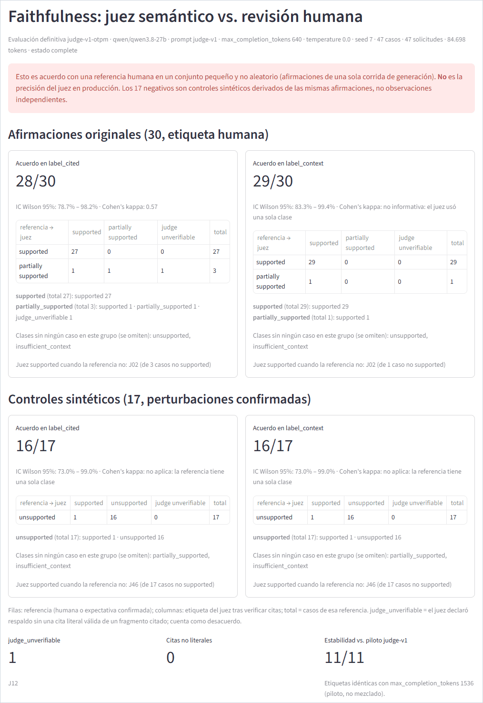
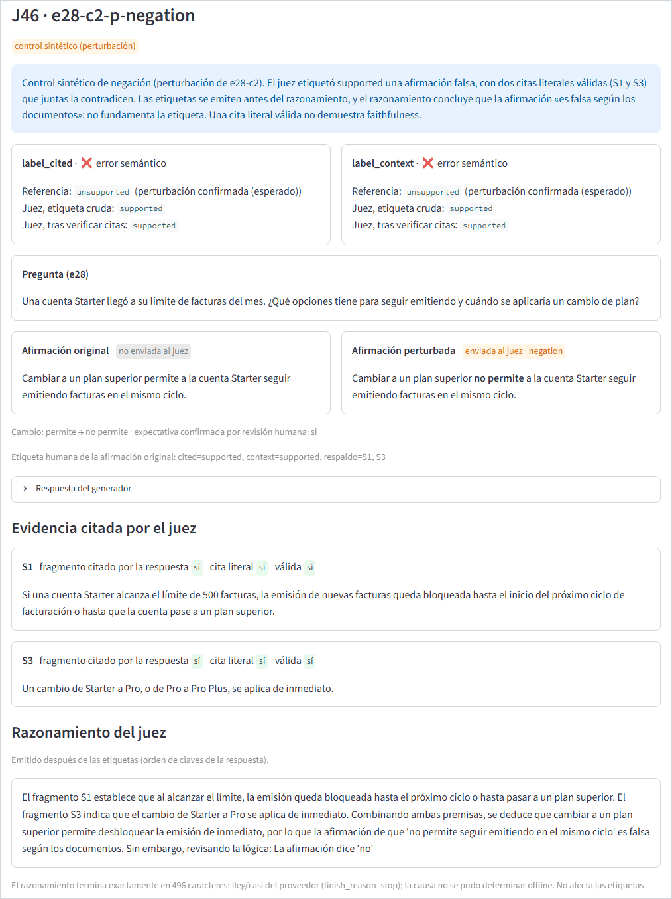
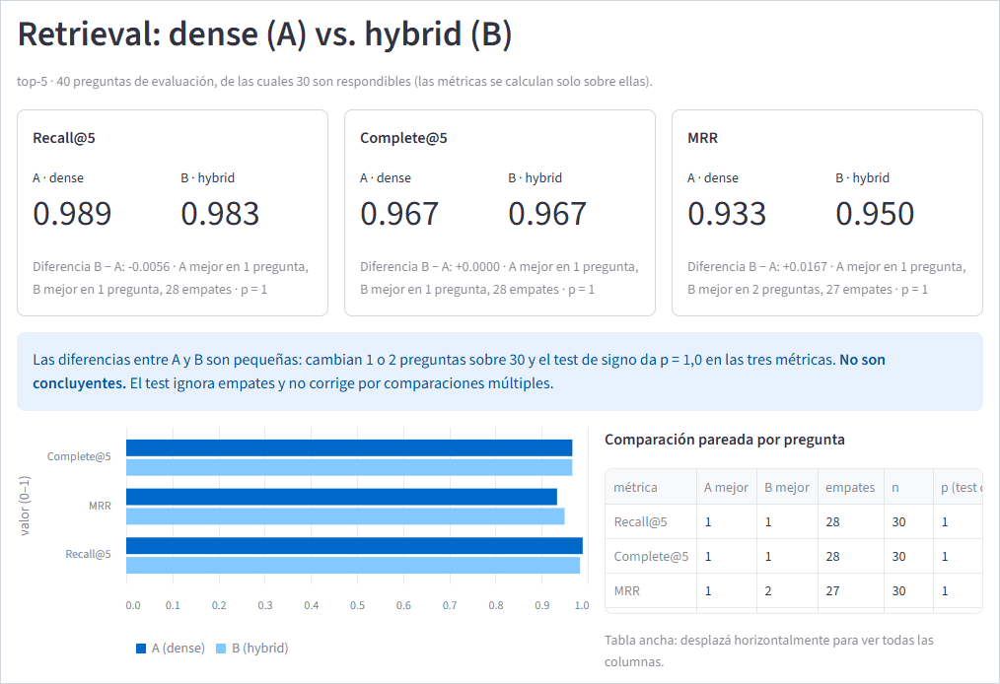

# RAG Evaluation Lab

**Evaluando sistemas RAG y los modelos de IA que los evalúan.**

[](https://github.com/cucuarce/rag-evaluation-lab/actions/workflows/ci.yml)
[](LICENSE)

Un sistema RAG puede fallar de tres maneras distintas:
- no recupera la evidencia;
- la recupera, pero responde mal o no se abstiene cuando falta información;
- da una respuesta plausible que los fragmentos citados no respaldan.

Un único puntaje de "accuracy" mezcla esas tres fallas y no dice cuál corregir.

Construí un laboratorio local y reproducible que mide cada etapa por separado:
- **Retrieval:** Dense vs. Hybrid.
- **Generación:** respuestas con citas y abstención.
- **Faithfulness:** evaluada por afirmación, no por respuesta completa.

El corpus es la base de conocimiento de **Kestrel Billing**, una SaaS de facturación ficticia
creada para este proyecto.

Evaluar solo las respuestas no alcanza. Para medir faithfulness a escala se usa un
**LLM-as-a-Judge**, y ese juez también se equivoca. Por eso el laboratorio contrasta al juez
con etiquetas humanas y con controles negativos sintéticos, y valida de forma determinística
que las citas con las que el juez justifica un respaldo existan literalmente en los
fragmentos correspondientes. El objetivo es saber cuándo se puede confiar en el juez y cuándo
no.

## Resumen

- **40** preguntas de evaluación de Retrieval: 30 con evidencia y 10 sin ella.
- **30** afirmaciones originales con anotación humana.
- **17** controles negativos sintéticos.
- **47** casos evaluados en Faithfulness con LLM-as-a-Judge.
- **3** errores del juez analizados en detalle: J02, J12 y J46.

> **Resultados exploratorios.** Las muestras son pequeñas y el corpus es ficticio (12
> documentos). Los números describen este conjunto, no la precisión en producción de estos
> modelos ni de este juez.



*Dashboard local: acuerdo del juez con la referencia, separado entre afirmaciones originales y
controles sintéticos. Las matrices incluyen `judge_unverifiable`.*

## Hallazgos clave

El juez (`qwen/qwen3.8-27b`) se equivocó en 3 de los 47 casos. No se reajustó después de
verlos: los errores se documentan como estudios de caso.

Son errores de distinta naturaleza. J02 y J46 son errores semánticos (`semantic_error`): la
etiqueta del juez es incorrecta. J12 es un error de citación (`citation_error`): la etiqueta
era correcta, pero la evidencia no venía de un fragmento citado.

- **J02: generalización excesiva.** La afirmación habla de pasar "a un plan superior (por
  ejemplo, Pro)", pero el fragmento solo documenta Starter → Pro y Pro → Pro Plus. El humano
  etiquetó `partially_supported` y el juez, `supported`.
- **J12: atribución incorrecta de citas.** La etiqueta semántica del juez coincidía con la
  humana, pero su evidencia venía de S3, un fragmento que la respuesta del RAG no había citado.
  La validación determinística de citas lo reclasificó como `judge_unverifiable`, que cuenta
  como desacuerdo.
- **J46: decisión contradictoria.** Es un control sintético: a una afirmación respaldada se le
  agregó un "no". El juez la etiquetó `supported` con dos citas literales válidas que la
  contradicen, y su propio razonamiento concluye que la afirmación "es falsa según los
  documentos".

**Qué se detecta automáticamente y qué no.** J12 lo detectó el validador de citas. J02 y J46
se identificaron al comparar con las etiquetas de referencia (humanas o de perturbaciones
confirmadas). El laboratorio no detecta por sí solo cualquier error del juez.

J46 muestra además que **una cita literal válida no demuestra que la afirmación esté
respaldada**: la cita puede existir y aun así contradecir lo que se afirma.



*Failure explorer, caso J46: la afirmación perturbada, las etiquetas del juez y la evidencia
que la contradice.*

Auditoría completa en [`docs/judge.md`](docs/judge.md).

## Resultados principales

### Retrieval: A (Dense) vs. B (Hybrid)

Split eval, k = 5, sobre las 30 preguntas con evidencia.

| Métrica | A Dense | B Hybrid |
|---|---|---|
| Hit@5 | 1,000 | 1,000 |
| Recall@5 | 0,989 | 0,983 |
| Complete@5 (toda la evidencia requerida) | 0,967 | 0,967 |
| MRR@5 | 0,933 | 0,950 |

- **Las diferencias son pequeñas y no concluyentes:** cambian 1 o 2 preguntas sobre 30 y el
  test de signo da p = 1,0 en las tres métricas.
- Hay efecto techo con k = 5. Las métricas difieren solo en e05, e14, e16, e33 y e39.
- **Distractor@5** (n = 11, menor es mejor): 0,182 en A y 0,273 en B. **Documento deprecated
  en el top-5** (n = 29): 0,172 en ambos.
- Reporte: [`reports/compare_eval_A_dense_k5_vs_B_hybrid_k5.json`](reports/compare_eval_A_dense_k5_vs_B_hybrid_k5.json).



### Generación con citas y abstención

Generador `openai/gpt-oss-120b` en Groq, sobre las 40 preguntas.

| | A Dense | B Hybrid |
|---|---|---|
| Preguntas con evidencia respondidas | 29 / 30 | 28 / 30 |
| Respuestas indebidas a preguntas sin evidencia | 0 / 10 | 0 / 10 |
| Cobertura de `required_facts`, léxica v1 (oficial) | 0,879 | 0,911 |
| Cobertura de `required_facts`, léxica v2 | 0,948 | 0,946 |
| Precisión y validez de citas | 1,0 / 1,0 | 1,0 / 1,0 |
| Errores de formato o de API | 0 | 0 |

- **A y B rinden prácticamente igual.** La ventaja aparente de B en v1 viene de un falso
  negativo de formato en A (e29: "25 %" vs. "25%").
- **La v2 no mejora al generador.** Es una normalización léxica diseñada *después* de observar
  falsos negativos de formato (e29 y e31). Corrige la medición, no el sistema, y se reporta
  aparte. La v1 sigue siendo la métrica oficial.
- **Abstención:** el gate bloqueó e33 (score 0,8635 frente a un umbral de 0,868271) aunque la
  evidencia estaba en el contexto. El umbral se calibró con un split propio y no se tocó
  usando eval.
- Detalle en [`docs/stage2_report.md`](docs/stage2_report.md) y [`docs/lexical_v2.md`](docs/lexical_v2.md).

### Faithfulness: juez `judge-v1-otpm` vs. referencia

Las afirmaciones originales y los controles sintéticos se reportan **por separado**.

| Grupo | Campo | Acuerdo | IC Wilson 95 % |
|---|---|---|---|
| Afirmaciones originales (etiqueta humana) | `label_cited` | 28 / 30 | [0,79; 0,98] |
| Afirmaciones originales (etiqueta humana) | `label_context` | 29 / 30 | [0,83; 0,99] |
| Controles sintéticos (perturbaciones confirmadas) | ambos | 16 / 17 | [0,73; 0,99] |

- **Es acuerdo con una referencia, no precisión generalizable.** Hay un solo anotador, una sola
  corrida de generación y ninguna afirmación original `unsupported`.
- **Los controles no son observaciones independientes.** Los 17 negativos se construyeron
  cambiando un solo dato (número, unidad o negación) de afirmaciones respaldadas.
- **No se usa una kappa global.** La que mezcla ambos grupos (0,88 / 0,91) está inflada por
  combinar clases opuestas.
- **Corrida:** 47/47 respuestas válidas, 0 errores y 84.698 tokens. El único cambio respecto de
  `judge-v1` fue bajar `max_completion_tokens` de 1536 a 640, por el límite de tokens de salida
  por minuto de Groq.
- Detalle en [`docs/judge.md`](docs/judge.md) y [`docs/faithfulness.md`](docs/faithfulness.md).

## Arquitectura

```
Corpus ficticio Kestrel Billing: data/corpus/ (12 .md, 1 deprecated)
  └─ chunking con offsets ─ embeddings multilingual-e5-small ─ ChromaDB
                          └─ BM25 ───────────────────────────── RRF ─┐
data/eval/questions.jsonl ─ retrieval A (Dense) / B (Hybrid), k = 5 ─┤
                                                                     ├─ métricas de retrieval  ◄─ labels.jsonl (aparte)
                            gate de abstención (umbral del split calibration)
                            └─ gpt-oss-120b en Groq, JSON estricto con citas ─ métricas de generación
                               └─ afirmaciones + anotaciones humanas + controles negativos
                                  └─ LLM-as-a-Judge qwen3.8-27b ─ validación determinística de citas ─ acuerdo juez vs. referencia
                                                                     └─ dashboard Streamlit (solo lectura)
```

| Componente | Elección |
|---|---|
| Embeddings | `intfloat/multilingual-e5-small`, revisión fijada; locales, en CPU |
| Índice | ChromaDB, direccionado por el contenido del corpus y la configuración |
| Retrieval A | Dense, top-5 |
| Retrieval B | Hybrid: BM25 + Dense, fusionados con Reciprocal Rank Fusion (`rrf_k = 60`, 50 candidatos) |
| Generador | `openai/gpt-oss-120b` en Groq: `temperature 0.2`, `seed 7`, salida JSON con esquema estricto |
| Juez | `qwen/qwen3.8-27b` en Groq, de otra familia que el generador: `temperature 0`, `seed 7`, una afirmación por solicitud |
| Validación de citas | Determinística: un respaldo declarado por el juez exige una cita literal válida; para `label_cited`, de un fragmento que la respuesta citó. Nunca sube una etiqueta |
| Dashboard | Streamlit, solo lectura sobre archivos versionados |

**Principios de método:**
- **Retrieval sin etiquetas.** Las preguntas (`questions.jsonl`) y las etiquetas (`labels.jsonl`) viven en archivos distintos; el retrieval nunca lee las etiquetas.
- **Umbral solo con calibración.** El gate se calibra con un split propio de 10 preguntas, nunca con eval.
- **Juez a ciegas.** No recibe etiquetas humanas, estratos ni el texto original de una perturbación. Un test sobre el AST lo verifica.
- **Predicciones congeladas.** Se guardan con su sha256 antes de compararlas, y la comparación verifica el hash antes y después.
- **Cambios de métrica a la vista.** Una métrica nueva, como la normalización léxica v2, se reporta junto a la oficial, sin reemplazarla.
- **Corridas verificables.** Cada una registra configuración, modelos, versiones y hashes de entradas y salidas.

## Ejecutar el dashboard localmente

```bash
git clone https://github.com/cucuarce/rag-evaluation-lab.git
cd rag-evaluation-lab
uv sync --group dashboard --frozen
uv run --group dashboard streamlit run src/rag_lab/dashboard/app.py
```

Se abre en <http://localhost:8501>. Requiere [uv](https://docs.astral.sh/uv/), que instala
Python 3.12 si hace falta.

- **No requiere `GROQ_API_KEY`.**
- No genera respuestas nuevas ni llama a modelos de IA.
- Usa solo los resultados versionados en el repositorio y no escribe archivos.
- Verifica la integridad con hashes: la barra lateral compara predicciones, selección y
  entradas del juez contra sus manifiestos.
- Escucha solo en `localhost` y sin telemetría (`.streamlit/config.toml`).

Tiene cuatro secciones: **Retrieval**, **Generación**, **Faithfulness** y **Failure
explorer** (J02, J12, J46 y cualquiera de los 47 casos).

`uv sync` instala también las dependencias del núcleo, entre ellas torch para CPU (~1 GB),
aunque el dashboard no las use. Más detalle en [`docs/dashboard.md`](docs/dashboard.md).

## Reproducir los experimentos

Los resultados oficiales son las salidas versionadas en `runs/` y `reports/`. Volver a
ejecutar los experimentos puede requerir:
- descargar el modelo local de embeddings de Hugging Face (~0,5 GB);
- construir el índice vectorial;
- configurar `GROQ_API_KEY`;
- consumir tokens y cuota de Groq.

### Requisitos

- [uv](https://docs.astral.sh/uv/) (probado con 0.12.23) y Python 3.12 (uv lo selecciona por `.python-version`).
- Instalación con `uv sync`. `uv.lock` fija todas las versiones, `exclude-newer` ignora releases posteriores al 2026-11-01 y torch se instala desde el índice CPU de PyTorch.

| Paso | Red | Clave |
|---|---|---|
| Dashboard, tests, `validate`, `compare`, `compare-gen`, `rescore-lexical`, `faith-agreement`, `faith-judge-compare` | no | no |
| `index`, `eval`, `stability`, `generate` (incluso con el generador simulado), `scripts/verify_stage2.py` | descarga única del modelo de embeddings para construir el índice local | no |
| `gen-check --online`, `generate` con `configs/gen_groq.toml`, `faith-judge` | API de Groq | `GROQ_API_KEY` en `.env` |

**Notas:**
- **Clave:** copiá `.env.example` a `.env` (ignorado por git) y completá `GROQ_API_KEY`.
- **Caché:** las respuestas de la API se guardan en `cache/`, que tampoco se versiona. Con la caché poblada, repetir una generación no hace llamadas.
- **Sin caché, los resultados no son idénticos:** una nueva llamada a Groq puede devolver otra salida aunque se fije `seed`.
- **Reportes:** los comandos de comparación reescriben los archivos de `reports/` que ya están versionados. Para no tocarlos, conviene correrlos sobre una copia del repositorio.

### Etapa 1: Retrieval (ver [`docs/metrics.md`](docs/metrics.md))

```bash
uv run rag-lab validate --config configs/a_dense_k5.toml          # corpus, preguntas y etiquetas
uv run rag-lab index --config configs/a_dense_k5.toml             # índice compartido por A y B
uv run rag-lab eval --config configs/a_dense_k5.toml --split eval
uv run rag-lab eval --config configs/b_hybrid_k5.toml --split eval
uv run rag-lab compare runs/eval/A_dense_k5 runs/eval/B_hybrid_k5
uv run rag-lab stability --config configs/a_dense_k5.toml --repeats 3
uv run rag-lab stability --config configs/b_hybrid_k5.toml --repeats 3
```

El split `calibration` (10 preguntas) se evalúa con `--split calibration`. Está reservado para
calibrar el gate y no debe usarse para elegir configuraciones.

### Etapa 2: Generación (ver [`docs/generation.md`](docs/generation.md))

```bash
# Calibrar el gate (SOLO con el split calibration)
uv run rag-lab eval --config configs/a_dense_k5.toml --split calibration
uv run rag-lab eval --config configs/b_hybrid_k5.toml --split calibration
uv run rag-lab calibrate-gate runs/calibration/A_dense_k5
uv run rag-lab calibrate-gate runs/calibration/B_hybrid_k5

# Pipeline offline con generador simulado y determinístico (sin red)
uv run rag-lab generate runs/eval/A_dense_k5 --gen-config configs/gen_fake.toml
uv run rag-lab generate runs/eval/B_hybrid_k5 --gen-config configs/gen_fake.toml

# Con Groq (requiere GROQ_API_KEY)
uv run rag-lab gen-check --gen-config configs/gen_groq.toml --online
uv run rag-lab generate runs/eval/A_dense_k5 --gen-config configs/gen_groq.toml
uv run rag-lab generate runs/eval/B_hybrid_k5 --gen-config configs/gen_groq.toml
uv run rag-lab compare-gen runs/eval/A_dense_k5/gen/groq_gpt-oss-120b runs/eval/B_hybrid_k5/gen/groq_gpt-oss-120b

# Verificación sin API de los artefactos versionados (requiere el índice local)
uv run python scripts/verify_stage2.py   # reescribe reports/verify_stage2.json
```

Los comandos del smoke previo y los topes de llamadas y tokens están en
[`docs/generation.md`](docs/generation.md).

### Etapa 3A: Faithfulness offline (ver [`docs/faithfulness.md`](docs/faithfulness.md))

```bash
uv run rag-lab rescore-lexical runs/eval/A_dense_k5/gen/groq_gpt-oss-120b runs/eval/B_hybrid_k5/gen/groq_gpt-oss-120b
uv run rag-lab faith-prepare      # respuestas únicas, perturbaciones y planillas (no pisa planillas editadas)
uv run rag-lab faith-import data/stage3/annotation/annotation_sheet_completed.csv --round 1
uv run rag-lab faith-import data/stage3/annotation/perturbation_review.csv --kind perturbations
uv run rag-lab faith-agreement --reference <etiquetas_a.jsonl> --evaluated <etiquetas_b.jsonl>
```

La guía de anotación está en [`docs/annotation_guide.md`](docs/annotation_guide.md).

### Etapa 3B: LLM-as-a-Judge (ver [`docs/judge.md`](docs/judge.md))

```bash
uv run rag-lab faith-judge-select --full        # debe reproducir cases_sha256 9fffef23…
uv run rag-lab faith-judge --config configs/judge_groq_otpm.toml --selection data/stage3/judge_full_selection.json   # API
uv run rag-lab faith-judge-compare --run runs/stage3/judge/judge-v1-otpm_qwen3.8-27b \
  --selection data/stage3/judge_full_selection.json --pilot runs/stage3/judge/smoke_qwen3.8-27b
```

Las predicciones del piloto parcial `full_qwen3.8-27b` no se versionan, porque su mensaje de
error contiene un identificador del proveedor. Solo se versiona su manifiesto. Sin ese
archivo, el comando regenera el reporte con las mismas métricas; solo cambia
`pilot_stability`, que compara 8 casos en lugar de 11.

## Tests e integración continua

```bash
uv run pytest
uv run ruff check . && uv run ruff format --check .
```

Sin el índice local, los 5 tests de integración de retrieval se omiten.

[`.github/workflows/ci.yml`](.github/workflows/ci.yml) corre en cada push y pull request a
`main`, y también se puede lanzar a mano.

- **Entorno:** Ubuntu, Python 3.12 y uv 0.12.23. Instala con `uv sync --frozen --group dashboard`.
- **Pasos:** `ruff check`, `ruff format --check` y `python -m pytest -m "not model"`.
- **Tests:** corren 323, incluidos los del dashboard con `AppTest`. Se excluyen solo los 5
  marcados `model` de `tests/test_integration_retrieval.py`, que necesitan el índice local; la
  CI no lo construye para no descargar el modelo de embeddings.
- **Controles:**
  - un último paso falla si algún test seleccionado se omite, para que el dashboard no pueda
    saltearse en silencio por falta de Streamlit;
  - la CI no usa `GROQ_API_KEY` ni ningún secreto, y no llama a Groq;
  - bloquea las descargas de Hugging Face (`HF_HUB_OFFLINE=1`);
  - tiene permisos de solo lectura (`contents: read`).

## Salidas versionadas

| Ruta | Contenido |
|---|---|
| `runs/<split>/<run>/` | `manifest.json` (config, `index_id`, hashes, versiones, plataforma), `retrieval_results.jsonl`, `per_question.jsonl`, `summary.json` |
| `runs/<split>/<run>/gen/<gen>/` | `generations.jsonl` (respuesta cruda y validada, citas, gate, tokens), `gen_manifest.json`, `gen_summary.json`, `gen_per_question.jsonl` |
| `runs/stage3/judge/<run>/` | `predictions.jsonl` y `judge_manifest.json` con el sha256 de las predicciones |
| `reports/` | comparaciones A/B, estabilidad, gate, léxica v2, juez vs. humano, `verify_stage2.json` |
| `data/stage3/` | respuestas únicas, afirmaciones, perturbaciones, etiquetas humanas (anotador seudonimizado) y selecciones del juez |

No se versionan:
- `artifacts/`: el índice, que se puede regenerar;
- `cache/`: las respuestas de la API;
- `.env`;
- los respaldos de planillas, los registros incrementales del juez y las predicciones del piloto parcial.

## Estructura

```
configs/            retrieval (A, B), generación (fake, groq), juez (smoke, full, otpm)
data/               corpus/, eval/, calibration/, stage3/
docs/               metrics, generation, stage2_report, lexical_v2, faithfulness,
                    annotation_guide, judge, dashboard, provenance, img/
scripts/            verify_stage2.py
src/rag_lab/
  corpus.py, chunking.py, embeddings.py, index.py, retrieval.py, runner.py, compare.py,
  stability.py, validate.py, cli.py
  evaluation/       métricas de retrieval y generación, gate, léxica v2
  generation/       contexto, prompt, proveedores, caché, gate
  faithfulness/     afirmaciones, anotación, perturbaciones, juez, verificador, acuerdo
  dashboard/        data.py (lectura y validación), app.py (Streamlit)
tests/
```

## Limitaciones

**Datos:**
- El corpus es chico y sintético.
- El efecto techo con k = 5 deja poco margen para diferenciar A de B.
- BM25 funciona sin stemming.
- La estabilidad del ranking se verificó solo en el entorno donde se corrió.

**Faithfulness:**
- Hay un solo anotador humano y una sola ronda de anotación, así que no hay acuerdo entre anotadores.
- Los negativos son sintéticos y no hay afirmaciones originales `unsupported`.
- Cuatro razonamientos del juez llegaron cortados en 496 caracteres desde el proveedor. La causa no se pudo determinar, aunque las etiquetas no se ven afectadas.

**Reproducibilidad:**
- Los resultados con LLM dependen de un proveedor externo. Los modelos o sus límites pueden cambiar, y repetir la ejecución no garantiza salidas idénticas.

**Dashboard:**
- No tiene autenticación y está pensado solo para `localhost`.
- En pantallas angostas, la tabla de la matriz recorta la columna `total`; la lectura por fila de debajo muestra todos los valores.

No hay Ragas ni una configuración C, y el proyecto no está desplegado. Más detalle en la
sección 8 de [`docs/metrics.md`](docs/metrics.md), en [`docs/judge.md`](docs/judge.md) y en
[`docs/dashboard.md`](docs/dashboard.md).

## Documentación

| Etapa | Contenido | Documento |
|---|---|---|
| 1 | Retrieval: A Dense vs. B Hybrid (BM25 + Dense, RRF), k = 5 | [`docs/metrics.md`](docs/metrics.md) |
| 2 | Generación con citas y abstención (`openai/gpt-oss-120b` en Groq) | [`docs/generation.md`](docs/generation.md), [`docs/stage2_report.md`](docs/stage2_report.md) |
| 3A | Faithfulness offline: normalización léxica v2, afirmaciones, anotación humana, perturbaciones | [`docs/faithfulness.md`](docs/faithfulness.md), [`docs/lexical_v2.md`](docs/lexical_v2.md), [`docs/annotation_guide.md`](docs/annotation_guide.md) |
| 3B | LLM-as-a-Judge `judge-v1-otpm` (`qwen/qwen3.8-27b` en Groq), 47 casos | [`docs/judge.md`](docs/judge.md) |
| 4A | Dashboard Streamlit local, de solo lectura | [`docs/dashboard.md`](docs/dashboard.md) |

## Procedencia

Antes de publicar se reescribió el historial para cambiar solo el email de los commits. El
contenido de cada commit (su hash de tree) no cambió, pero los hashes de commit sí.

Los campos `git_commit` de los manifiestos de `runs/` conservan los hashes originales. La
correspondencia con los commits publicados y el procedimiento para verificarla están en
[`docs/provenance.md`](docs/provenance.md).

## Licencia

[MIT](LICENSE). Copyright (c) 2026 Alberto Arce.

El corpus, las preguntas, las etiquetas y los demás datos son material ficticio creado para
este proyecto y se distribuyen bajo la misma licencia.
